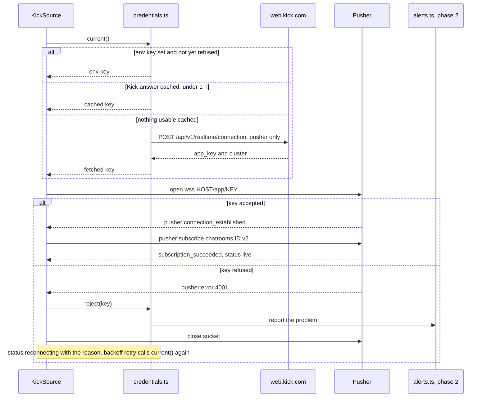
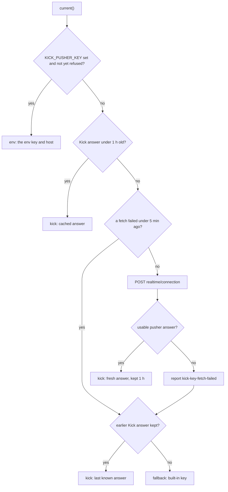

# All Chat — Kick Realtime Credentials (EDD-kick-credentials)

| | |
|---|---|
| **Status** | Complete |
| **Date** | 2026-11-14 |
| **Scope** | Resolve Kick's Pusher app key at connect time; surface key failures, including to Discord |
| **Author** | Gregory McQuillan |
| **Executor** | Claude Sonnet, autonomously, on branch `feature/auto-fetch-kick-token` (§6) |
| **License** | This document is CC BY-SA 4.0 — see [docs/LICENSE](LICENSE). Source code elsewhere in this repo is licensed separately (root [LICENSE](../LICENSE), [shared/contract/LICENSE](../shared/contract/LICENSE)). |
| **Builds on** | [2026-07-19-all-chat.edd.md §3.2](2026-07-19-all-chat.edd.md#32-kick) (Kick source) and its §7 risk row "Kick unofficial API changes". |

## 1. Overview

Kick chat connects through Pusher with an app key that Kick rotates without notice. Today the key is a constant in `kick/constants.ts`, overridable by `KICK_PUSHER_KEY`. Each rotation means a manual DevTools lookup, an env edit, and a restart.

Kick rotated the key on 2026-10-17. The built-in default (`32cbd69e4b950bf97679`) is dead: any deployment without an env override cannot connect to Kick right now.

kick.com's own web client asks an endpoint which realtime provider and credentials to use. This plan calls the same endpoint, so the next rotation heals on reconnect with no deploy. Failures are reported, first to the console and source status (phase 1), then to a Discord webhook (phase 2).

## 2. Investigation findings

All "verified" rows were run on 2026-11-14.

### 2.1 Is there an official way to get this key? No.

| # | Route | Official | Gives the Pusher key | Fits All Chat |
|---|---|---|---|---|
| 1 | Public API (`api.kick.com/public/v1`, OAuth 2.1) | Yes | No. No WebSocket chat and no realtime credentials are documented. | n/a |
| 2 | Webhook event `chat.message.sent` | Yes | Not needed, it replaces the socket | No (see below) |
| 3 | `POST web.kick.com/api/v1/realtime/connection` | No, undocumented | Yes | Yes — chosen |
| 4 | Scrape kick.com's JS bundle or WS traffic | No | Not any more | No |

1. Route 2 is the only official chat-read path. It needs a registered Kick app, an OAuth token with `events:subscribe`, and a webhook endpoint Kick can reach. App-token subscriptions must name a `broadcaster_user_id`, and unverified apps are capped at 1,000 `chat.message.sent` subscriptions. The docs do not say whether a channel that has not authorized the app can be subscribed.
2. That conflicts with two v1 properties: anonymous read with no app registration, and self-hosted deployments on a LAN that Kick cannot call back.
3. Route 4 was the original idea. Community reports say the web client stopped hardcoding the key and fetches it from route 3. Not confirmed against the bundle; route 3 makes it moot.
4. Route 3 is unofficial but is the first-party client's own path. It needs no login and no cookie.

### 2.2 Verified behaviour of the endpoint

Request, offering Pusher only:

```sh
curl -sS -X POST https://web.kick.com/api/v1/realtime/connection \
  -H 'content-type: application/json' -H 'accept: application/json' \
  -d '{"client":{"id":"0b7c1c1e-3d0a-4c58-9d0e-6a3f0c1d2e4f","type":"web"},"capabilities":{"accepted_providers":[{"provider":"pusher"}]}}'
```

Response (HTTP 200, served through Cloudflare, no challenge with Node's default user agent):

```json
{"data":{"connections":[{"credentials":{"app_key":"34bf7a0ff419a2a775b9","cluster":"us2"},"provider":"pusher"}],"mode":"websocket"},"message":"success"}
```

| # | Check | Result |
|---|---|---|
| 1 | Empty body `{}` | `400 {"data":{"type":"Bad Request"}}` |
| 2 | Offer `pusher` and `centrifugo` | Kick answers Centrifugo only: `wss://realtime.us-east-1.platform.kick.com/connection/websocket` |
| 3 | Handshake with old key `32cbd69e…` | First frame is `{"event":"pusher:error","data":{"code":4001,"message":"App key … not in this cluster. Did you forget to specify the cluster?"}}` |
| 4 | Handshake with new key `34bf7a0f…` | `pusher:connection_established` |
| 5 | `GET kick.com/api/v2/channels/<slug>` (existing lookup) | 200, unchanged |

Note row 3: the error frame's `data` is a JSON **object**. Every other Pusher frame carries `data` as a JSON **string**.

### 2.3 Two problems in the current code

1. The fallback key in `constants.ts` and `.env.example` is the retired one.
2. `KickSource` ignores `pusher:error`. A refused key shows as an endless "connection closed; retry in Ns" with no hint that the key is the cause.

## 3. Goals / Non-goals

### Goals

1. Try `KICK_PUSHER_KEY` first when it is set. It is a first guess, not a pin.
2. When Pusher refuses a key, fetch the current one from Kick and reconnect. No restart.
3. Keep working when Kick's endpoint is down: last known answer, then a built-in fallback.
4. Report every key problem: console and source status in phase 1, Discord webhook in phase 2.

### Non-goals

1. A Centrifugo transport. Kick prefers it when offered, so Pusher may be retired later. That needs its own doc.
2. The official webhook route (§2.1).
3. Persisting the last known key to `/data`.
4. Discord alerts for anything other than Kick key problems (e.g. every source `failed` state).
5. Any change to the chatroom lookup, normalizer, contract, UI, or `manager.ts`.

## 4. Design

### 4.1 Connect flow



### 4.2 Which credentials `current()` returns



### 4.3 What gets reported

| Problem id | When | Severity | What the operator should do |
|---|---|---|---|
| `kick-env-key-refused` | Pusher refuses the `KICK_PUSHER_KEY` value. Reported once per process. | Recovered automatically | Update or remove `KICK_PUSHER_KEY` |
| `kick-key-fetch-failed` | Kick's endpoint is unreachable, non-200, or returns no usable Pusher credentials | Degraded: running on last known or fallback key | Check whether Kick changed the endpoint or dropped Pusher |
| `kick-fetched-key-refused` | Pusher refuses a key Kick handed out under 60 s ago | Broken: Kick chat cannot connect | Same as above |

A cached answer refused after it has aged past 60 s is a normal rotation. It is not reported; the retry fetches the new key.

### 4.4 Decisions

1. **Env key is a first guess.** It is tried first on connect with no network call. Once Pusher refuses it, it is ignored for the rest of the process and the problem is reported.
2. **`KICK_PUSHER_HOST` only applies together with `KICK_PUSHER_KEY`.** Without a key it is ignored.
3. **Kick answers are kept 1 h.** One request serves every Kick source. Concurrent callers share one in-flight request.
4. **Offer Pusher only.** Offering Centrifugo makes Kick return it instead (§2.2 row 2).
5. **`reject` only acts on a key the store handed out.** A late refusal of an old key cannot evict a newer one.
6. **After a failed fetch, wait 5 min before asking Kick again.** Existing source backoff (cap 30 s) paces reconnects in between.
7. **Validate before use.** `cluster` is interpolated into a hostname, so it must match `^[a-z0-9-]+$`. `app_key` must match `^[A-Za-z0-9]+$`.
8. **Plain user agent.** The endpoint answers Node's default today. No browser impersonation.
9. **`current()` never rejects.** Every failure path returns a stand-in and reports.
10. **Env is read lazily.** `hooks.server.ts` calls `loadSecretsFile()` at startup, which fills `process.env` after modules may have loaded. Read `process.env` inside methods, never at module top level.
11. **Discord webhook URL is a secret.** Never log it. It is read from `ALERT_DISCORD_WEBHOOK_URL`, so it also works through the secrets file.
12. **Alerts never break chat.** Posting to Discord is fire-and-forget; its failure is a `console.warn`.
13. **One Discord message per problem id per hour.** The console line is never suppressed.

## 5. Files

```
all-chat/
├─ .env.example                                   modified
├─ docker-compose.yml                             modified
├─ CHANGELOG.md                                   modified
├─ docs/
│  ├─ 2026-07-19-all-chat.edd.md                  modified (§3.2, §7 wording)
│  └─ 2026-11-14-kick-realtime-credentials.edd.md new (this file)
└─ web/src/lib/server/
   ├─ alerts.ts                                   new (phase 2)
   ├─ alerts.test.ts                              new (phase 2)
   ├─ manager.ts                                  unchanged
   └─ sources/
      ├─ socket.ts                                unchanged
      └─ kick/
         ├─ constants.ts                          modified
         ├─ credentials.ts                        new
         ├─ credentials.test.ts                   new
         ├─ index.ts                              modified
         ├─ source.test.ts                        modified
         ├─ lookup.ts                             unchanged
         └─ normalize.ts                          unchanged
```

These files are pre-approved. Any other new file, extraction, or refactor: stop and ask (§6.5).

## 6. Execution protocol

This section is addressed to the executing agent.

### 6.1 Authorization

1. The user's global instructions say never to run `git commit`. For this plan the user has explicitly authorized committing on `feature/auto-fetch-kick-token`. This applies to this branch and this plan only.
2. Work through §7 top to bottom without waiting for approval between steps. One step is one commit.
3. The files in §5 are pre-approved, so the "warn ahead" rule is already satisfied for them.

### 6.2 Git rules

Allowed:

1. `git status`, `git diff`, `git log`, `git show`, `git branch --show-current`.
2. `git add <explicit paths>` and `git commit` on `feature/auto-fetch-kick-token`.
3. `git commit --fixup=<sha>` followed by a non-interactive autosquash (§6.4), for commits on this branch only.

Forbidden, no exceptions:

1. `git push` in any form.
2. Checking out, committing to, merging into, rebasing, or resetting `master`. Reading it (`git log master..HEAD`) is fine.
3. `git add -A`, `git add .`, `git commit -a`. Add named paths only.
4. `git stash`, `git reset --hard`, `git clean`, merge commits, new branches, tags.
5. `--no-verify`, and any history rewrite beyond §6.4.

Before the first edit:

Run from the repository root:

```sh
git branch --show-current   # must print feature/auto-fetch-kick-token
git status --short          # expect only: ?? docs/2026-11-14-kick-realtime-credentials.edd.md
git log --oneline master..HEAD   # expect empty
```

If the branch is wrong, run `git switch feature/auto-fetch-kick-token` (it already exists). If the other two outputs differ, stop and ask.

### 6.3 Per-step loop

1. Make only the changes the step lists.
2. Run the gate from the repo root. All three must pass:
   ```sh
   npm run check && npm test && npm run build
   ```
3. Check the diff is only what the step lists: `git status --short && git diff --stat`.
4. Commit with the step's exact subject line, adding named paths only:
   ```sh
   git add web/src/lib/server/sources/kick/constants.ts .env.example
   git commit -m "[web][kick] fix: replace retired Pusher fallback key to restore Kick chat"
   ```
   Add a body (`-m` twice) only when the step gives one. Let the harness append its own attribution trailer.
5. Confirm the tree is clean (`git status --short` prints nothing) before starting the next step.

### 6.4 Fixing an earlier commit

The user reviews commits one at a time, in order. A fix for step N belongs in step N's commit, never in a later "fix" commit.

```sh
git add <paths>
git commit --fixup=<sha of step N>
GIT_SEQUENCE_EDITOR=true git rebase -i --autosquash master
git rebase --exec 'npm run check && npm test && npm run build' master
```

If either rebase stops with a conflict or a failing gate, run `git rebase --abort` and ask.

### 6.5 When to stop and ask

Stop, leave the tree as it is, and message the user (send a push notification too if that tool is available) when:

1. The gate fails and two attempts at a fix within the step's own files have not fixed it.
2. A step needs a file, dependency, or refactor not listed in §5.
3. The code no longer matches what this doc describes (line references are from commit `5ba3fa8`).
4. Kick's endpoint behaves differently from §2.2 during the optional live check.
5. Any git command outside §6.2 "Allowed" seems necessary.
6. A design question comes up that §4 does not answer. Do not guess.

Say which step, what was tried, and the exact error output.

### 6.6 Code conventions

1. Tabs for indentation, single quotes, matching the surrounding files.
2. Comments are terse and say why, not what. JSDoc for functions, types, and members. No change history in comments.
3. A non-doc comment goes on the first line inside the block it explains.
4. Name magic numbers with constants.
5. Tests use made-up keys such as `'test-key'`. Never put a real Kick key in a test file.
6. No test may touch the network.
7. Nothing local or private goes into a committed file or a commit message: no absolute paths, home directories, machine or user names, email addresses, webhook URLs, tokens, or channel names taken from the user's own setup. Use repo-relative paths and made-up values. Before each commit, check the staged diff:
   ```sh
   git diff --cached | grep -n -i '/[U]sers/\|/[h]ome/\|/[p]rivate/\|/[t]mp/\|@[g]mail\|[d]iscord.com/api/webhooks' && echo 'STOP: private data staged'
   ```
   Any match: unstage, remove it, and re-run the gate. The brackets keep this line from matching itself. Test webhook URLs use a made-up host such as `https://discord.example/webhook`.
8. Never start a dev server. If one is started for any reason, stop it before the step ends.

## 7. Steps

Subjects use this repo's style: `[area] verb: what to why`. Keep each ≤ 72 characters.

### Phase 1 — auto-resolve the key

#### Step 0 — commit this plan

1. Files: `docs/2026-11-14-kick-realtime-credentials.edd.md` (already in the working tree).
2. Gate still runs.
3. Commit: `[docs] add: EDD for Kick realtime credentials`

#### Step 1 — replace the retired fallback key

Restores Kick chat on its own.

1. `web/src/lib/server/sources/kick/constants.ts`: in `KICK_PUSHER_KEY`, change the literal `'32cbd69e4b950bf97679'` to `'34bf7a0ff419a2a775b9'`. In its doc comment change "Current as of 2026-07" to "Current as of 2026-11". Nothing else.
2. `.env.example` line 11: change the commented value to `34bf7a0ff419a2a775b9`.
3. Commit: `[web][kick] fix: replace retired Pusher fallback key to restore Kick chat`

#### Step 2 — add `fetchPusherCredentials`, not wired in

1. `constants.ts`: add two constants below `KICK_CHANNEL_API`. Do not touch the existing ones.
   ```ts
   /** Asks Kick which realtime provider and credentials its web client should use. */
   export const KICK_REALTIME_CONNECTION_API = 'https://web.kick.com/api/v1/realtime/connection';

   export const KICK_PUSHER_CLUSTER_HOST = (cluster: string) => `ws-${cluster}.pusher.com`;
   ```
2. New `web/src/lib/server/sources/kick/credentials.ts`:
   ```ts
   import { KICK_PUSHER_CLUSTER_HOST, KICK_REALTIME_CONNECTION_API } from './constants';

   export interface PusherCredentials {
   	appKey: string;
   	host: string;
   	/** `env` = KICK_PUSHER_KEY, `kick` = Kick's realtime endpoint, `fallback` = built-in constant. */
   	origin: 'env' | 'kick' | 'fallback';
   }

   interface RealtimeConnectionResponse {
   	data?: {
   		connections?: { provider?: string; credentials?: { app_key?: unknown; cluster?: unknown } }[];
   	};
   }

   const FETCH_TIMEOUT_MS = 10_000;
   const APP_KEY_PATTERN = /^[A-Za-z0-9]+$/;
   /** The cluster becomes part of a hostname, so only a bare DNS label is accepted. */
   const CLUSTER_PATTERN = /^[a-z0-9-]+$/;

   const isAppKey = (value: unknown): value is string =>
   	typeof value === 'string' && APP_KEY_PATTERN.test(value);
   const isCluster = (value: unknown): value is string =>
   	typeof value === 'string' && CLUSTER_PATTERN.test(value);

   /** Asks Kick for its current Pusher app, offering Pusher only (offering Centrifugo makes Kick return that instead). */
   export async function fetchPusherCredentials(fetchFn: typeof fetch = fetch): Promise<PusherCredentials> {
   	const response = await fetchFn(KICK_REALTIME_CONNECTION_API, {
   		method: 'POST',
   		headers: { 'content-type': 'application/json', accept: 'application/json' },
   		body: JSON.stringify({
   			client: { id: crypto.randomUUID(), type: 'web' },
   			capabilities: { accepted_providers: [{ provider: 'pusher' }] }
   		}),
   		signal: AbortSignal.timeout(FETCH_TIMEOUT_MS)
   	});
   	if (!response.ok) {
   		throw new Error(`kick realtime lookup failed with status ${response.status}`);
   	}

   	const body = (await response.json()) as RealtimeConnectionResponse | null;
   	const pusher = body?.data?.connections?.find((connection) => connection.provider === 'pusher');
   	const { app_key: appKey, cluster } = pusher?.credentials ?? {};
   	if (!isAppKey(appKey) || !isCluster(cluster)) {
   		throw new Error('kick realtime response has no usable pusher credentials (shape drift?)');
   	}
   	return { appKey, host: KICK_PUSHER_CLUSTER_HOST(cluster), origin: 'kick' };
   }
   ```
3. New `web/src/lib/server/sources/kick/credentials.test.ts`, modelled on `lookup.test.ts`. Pass a `vi.fn()` as `fetchFn`. Cases:
   1. Returns `{ appKey, host: 'ws-us2.pusher.com', origin: 'kick' }` for a valid answer.
   2. Sends `POST` to `KICK_REALTIME_CONNECTION_API` with `accepted_providers` equal to `[{ provider: 'pusher' }]` and `client.type` equal to `'web'`.
   3. Throws on a non-200 status.
   4. Throws when the answer holds only a `centrifugo` connection.
   5. Throws when `cluster` is not a bare label (e.g. `'us2.evil.example/x'`).
   6. Throws when `data` is missing.
4. Commit: `[web][kick] add: fetch Pusher credentials from Kick's realtime endpoint`

#### Step 3 — add `KickCredentialStore`, not wired in

1. `constants.ts`: add the fallback constants and point the old default at them.
   ```ts
   /** Used only when Kick cannot be asked and no earlier answer is kept. Current as of 2026-11. */
   export const KICK_PUSHER_FALLBACK_KEY = '34bf7a0ff419a2a775b9';
   export const KICK_PUSHER_FALLBACK_HOST = 'ws-us2.pusher.com';
   ```
   Change the existing lines to `process.env.KICK_PUSHER_KEY || KICK_PUSHER_FALLBACK_KEY` and `process.env.KICK_PUSHER_HOST || KICK_PUSHER_FALLBACK_HOST`. They are removed in step 4.
2. `credentials.ts`: append the store.
   ```ts
   const KICK_ANSWER_TTL_MS = 60 * 60 * 1000;
   const RETRY_AFTER_FAILED_FETCH_MS = 5 * 60 * 1000;
   /** A key refused this soon after Kick handed it out means the answer is wrong, not stale. */
   const FRESH_ANSWER_WINDOW_MS = 60 * 1000;

   const FALLBACK_CREDENTIALS: PusherCredentials = {
   	appKey: KICK_PUSHER_FALLBACK_KEY,
   	host: KICK_PUSHER_FALLBACK_HOST,
   	origin: 'fallback'
   };

   export interface CredentialSource {
   	/** Credentials to try next (EDD-kick-credentials §4.2). Never rejects. */
   	current(): Promise<PusherCredentials>;
   	/** Pusher refused `appKey`; the next `current()` must not return it again. */
   	reject(appKey: string): void;
   }

   export type ReportProblem = (problemId: string, message: string) => void;

   const logProblem: ReportProblem = (_problemId, message) => console.error(`[kick] ${message}`);

   interface CredentialStoreDeps {
   	fetchCredentials: () => Promise<PusherCredentials>;
   	env: Record<string, string | undefined>;
   	now: () => number;
   	report: ReportProblem;
   }

   export class KickCredentialStore implements CredentialSource {
   	private readonly deps: CredentialStoreDeps;
   	private envKeyRefused = false;
   	private kickAnswer: PusherCredentials | undefined;
   	private kickAnswerAt = 0;
   	private nextFetchAt = 0;
   	private inFlight: Promise<PusherCredentials> | undefined;

   	constructor(deps: Partial<CredentialStoreDeps> = {}) {
   		this.deps = {
   			fetchCredentials: fetchPusherCredentials,
   			env: process.env,
   			now: Date.now,
   			report: logProblem,
   			...deps
   		};
   	}

   	async current(): Promise<PusherCredentials> {
   		const fromEnv = this.envCredentials();
   		if (fromEnv && !this.envKeyRefused) return fromEnv;

   		const now = this.deps.now();
   		if (this.kickAnswer && now - this.kickAnswerAt < KICK_ANSWER_TTL_MS) return this.kickAnswer;
   		if (now < this.nextFetchAt) return this.standIn();

   		this.inFlight ??= this.fetchKickAnswer().finally(() => {
   			this.inFlight = undefined;
   		});
   		return this.inFlight;
   	}

   	reject(appKey: string): void {
   		if (!this.envKeyRefused && this.envCredentials()?.appKey === appKey) {
   			this.envKeyRefused = true;
   			this.deps.report(
   				'kick-env-key-refused',
   				'KICK_PUSHER_KEY was refused by Pusher; fetching the current key from Kick. Update or remove KICK_PUSHER_KEY.'
   			);
   			return;
   		}
   		if (this.kickAnswer?.appKey !== appKey) return;

   		if (this.deps.now() - this.kickAnswerAt < FRESH_ANSWER_WINDOW_MS) {
   			this.deps.report(
   				'kick-fetched-key-refused',
   				'Pusher refused the chat key Kick just handed out; Kick chat cannot connect.'
   			);
   		}
   		this.kickAnswer = undefined;
   	}

   	/** Read on every call: the secrets file fills process.env after module load. */
   	private envCredentials(): PusherCredentials | undefined {
   		const appKey = this.deps.env.KICK_PUSHER_KEY;
   		if (!appKey) return undefined;
   		return { appKey, host: this.deps.env.KICK_PUSHER_HOST || KICK_PUSHER_FALLBACK_HOST, origin: 'env' };
   	}

   	private async fetchKickAnswer(): Promise<PusherCredentials> {
   		try {
   			this.kickAnswer = await this.deps.fetchCredentials();
   			this.kickAnswerAt = this.deps.now();
   			return this.kickAnswer;
   		} catch (error) {
   			this.nextFetchAt = this.deps.now() + RETRY_AFTER_FAILED_FETCH_MS;
   			const standIn = this.standIn();
   			this.deps.report(
   				'kick-key-fetch-failed',
   				`could not fetch the chat key from Kick (${(error as Error).message}); using ${
   					standIn.origin === 'fallback' ? 'the built-in fallback key' : 'the last known key'
   				}`
   			);
   			return standIn;
   		}
   	}

   	private standIn(): PusherCredentials {
   		return this.kickAnswer ?? FALLBACK_CREDENTIALS;
   	}
   }

   export const kickCredentials: CredentialSource = new KickCredentialStore();
   ```
   The sketch is the intended behaviour. Adjust syntax to pass `npm run check`; do not change behaviour.
3. `credentials.test.ts`: add a `describe('KickCredentialStore')`. Build each store with injected `fetchCredentials` (`vi.fn()`), `env` (plain object), `now` (a mutable clock variable), and `report` (`vi.fn()`). Cases:
   1. Env key set: `current()` returns `origin: 'env'` and never calls `fetchCredentials`.
   2. Env key set without `KICK_PUSHER_HOST`: host is `KICK_PUSHER_FALLBACK_HOST`.
   3. Env host set without env key: ignored, falls through to fetch.
   4. No env: fetches once; a second call inside 1 h reuses the answer.
   5. No env: fetches again after 1 h.
   6. Two concurrent `current()` calls share one fetch.
   7. Fetch fails with nothing kept: returns `origin: 'fallback'`, reports `kick-key-fetch-failed` once, does not fetch again within 5 min, fetches again after 5 min.
   8. Fetch fails after an earlier success and TTL expiry: returns the last known answer.
   9. `reject(envKey)`: reports `kick-env-key-refused`; next `current()` fetches from Kick; a second `reject(envKey)` does not report again.
   10. `reject` of a kept answer older than 60 s: no report; next `current()` fetches.
   11. `reject` of a kept answer younger than 60 s: reports `kick-fetched-key-refused`.
   12. `reject('unknown-key')`: no report, kept answer untouched.
4. Commit: `[web][kick] add: credential store that tries env key, then asks Kick`

#### Step 4 — resolve credentials in `KickSource.open()`

1. `constants.ts`:
   1. Delete `KICK_PUSHER_KEY`, `KICK_PUSHER_HOST`, and `KICK_PUSHER_URL` and their doc comments.
   2. Add the URL builder:
      ```ts
      /** Pusher WebSocket endpoint (protocol 7). */
      export const KICK_PUSHER_SOCKET_URL = (host: string, appKey: string) =>
      	`wss://${host}/app/${appKey}?protocol=7&client=js&version=8.4.0`;
      ```
   3. Update the file header comment: the key is no longer hardcoded here; point to `credentials.ts`.
   4. Confirm nothing else imports the deleted names: `grep -rn "KICK_PUSHER_KEY\b\|KICK_PUSHER_HOST\b\|KICK_PUSHER_URL" web/src` should only hit `credentials.ts` env reads.
2. `index.ts`:
   1. Import `KICK_PUSHER_SOCKET_URL` instead of `KICK_PUSHER_URL`; import `kickCredentials` and `type CredentialSource` from `./credentials`.
   2. Add a fifth constructor parameter: `private readonly credentials: CredentialSource = kickCredentials`.
   3. Make `open()` async:
      ```ts
      private async open(): Promise<void> {
      	if (this.attempts > 0) this.statusCb?.('reconnecting');
      	const credentials = await this.credentials.current();
      	if (this.closed) return;
      	const socket = this.createSocket(KICK_PUSHER_SOCKET_URL(credentials.host, credentials.appKey));
      	// rest unchanged
      }
      ```
   4. Callers: `if (!this.closed) await this.open();` in `resolveAndOpen`, and `setTimeout(() => void this.open(), jittered)` in `scheduleReconnect`.
   5. Update the class doc comment's flow line to mention the credential step.
3. `source.test.ts`:
   1. `newSource` passes a stub fifth argument: `{ current: () => Promise.resolve({ appKey: 'test-key', host: 'ws-test.pusher.com', origin: 'kick' }), reject: vi.fn() }`.
   2. The socket factory records each `url` it receives into a `urls: string[]` array reset in `beforeEach`.
   3. New case: the first socket URL is `wss://ws-test.pusher.com/app/test-key?protocol=7&client=js&version=8.4.0`.
   4. New case: `disconnect()` before the credentials resolve opens no socket.
   5. All existing cases must pass unchanged in intent.
4. Commit: `[web][kick] update: resolve Pusher key at connect so rotations self-heal`

#### Step 5 — handle a refused key

1. `index.ts`:
   1. Widen the envelope type:
      ```ts
      /** Pusher envelope: `data` is a JSON *string*, except on `pusher:error` where it is an object. */
      interface PusherEnvelope {
      	event?: string;
      	data?: string | { code?: number; message?: string };
      	channel?: string;
      }
      ```
   2. Add `const PUSHER_APP_KEY_REFUSED = 4001;` beside the backoff constants.
   3. Add fields `private credentialsInUse: PusherCredentials | undefined;` and `private keyRefusedDetail: string | undefined;`. Set `credentialsInUse` in `open()` right after the `closed` check.
   4. Replace the empty `pusher:error` case:
      ```ts
      case 'pusher:error': {
      	if (pusherErrorCode(envelope.data) !== PUSHER_APP_KEY_REFUSED || !this.credentialsInUse) return;
      	this.credentials.reject(this.credentialsInUse.appKey);
      	this.keyRefusedDetail = `kick refused the chat key (${KEY_ORIGIN_LABEL[this.credentialsInUse.origin]}); trying another`;
      	// Pusher does not always close after 4001; closing drives the normal reconnect path.
      	this.socket?.close();
      	return;
      }
      ```
      with a module-level `KEY_ORIGIN_LABEL: Record<PusherCredentials['origin'], string>` of `{ env: 'from KICK_PUSHER_KEY', kick: 'from Kick', fallback: 'built-in fallback' }`, and a small `pusherErrorCode(data)` helper that accepts the object form, also tries `JSON.parse` on a string form, and returns `number | undefined`.
   5. In `scheduleReconnect`, use the reason once:
      ```ts
      const reason = this.keyRefusedDetail ?? 'connection closed';
      this.keyRefusedDetail = undefined;
      this.statusCb?.('reconnecting', `${reason}; retry in ${Math.round(jittered / 1000)}s`);
      ```
2. `source.test.ts`. The fake's `receive()` stringifies `data`, so emit the raw frame for these: `sockets[0].emit('message', { data: JSON.stringify({ event: 'pusher:error', data: { code: 4001, message: 'App key test-key not in this cluster' } }) })`. Cases:
   1. On 4001: `reject` is called with `'test-key'`, the socket is closed, and the last status is `reconnecting` with a detail containing `refused the chat key`.
   2. With a stub whose `current()` returns `'test-key'` first and `'rotated-key'` second: after 4001 and `vi.advanceTimersByTimeAsync(1000)`, the second socket URL contains `/app/rotated-key`.
   3. A `pusher:error` with another code (e.g. 4200) does not call `reject`.
   4. A 4001 delivered with `data` as a JSON string is handled the same way.
3. Commit: `[web][kick] fix: refetch key when Pusher refuses it, and say why`

#### Step 6 — config comments and v1 EDD wording

1. `.env.example` lines 9–12 become:
   ```sh
   # Kick's Pusher key is fetched from kick.com automatically. If set, this key
   # is tried first; when Pusher refuses it the app fetches the current one and
   # logs a warning. KICK_PUSHER_HOST only applies together with KICK_PUSHER_KEY.
   #KICK_PUSHER_KEY=
   #KICK_PUSHER_HOST=
   ```
2. `docker-compose.yml` lines 13–14: reword the comment to match (key is auto-fetched; these are an optional first guess). Keep the two variable lines.
3. `docs/2026-07-19-all-chat.edd.md`:
   1. §3.2 last two paragraphs: replace the manual DevTools procedure and "restart to apply" wording with a two-sentence summary and a link to this doc.
   2. §7 risk row "Kick unofficial API changes": mitigation becomes "Key resolved at connect ([EDD-kick-credentials](2026-11-14-kick-realtime-credentials.edd.md)); constants isolated; fixture tests; manual chatroom-ID entry".
4. Commit: `[docs] update: describe Kick key auto-fetch in env comments and v1 EDD`

#### Step 7 — CHANGELOG for phase 1

1. `CHANGELOG.md`: follow the form of the two most recent `[docs] update: log …` commits (`git show 5ba3fa8 46d20c2`). Add:
   1. Under **Added**: Kick's Pusher key is fetched from kick.com at connect time; `KICK_PUSHER_KEY` is now an optional first guess.
   2. Under **Fixed**: retired Kick fallback key replaced; a refused key is now reported in the source status instead of looping silently.
2. Commit: `[docs] update: log Kick key auto-fetch in CHANGELOG`

### Phase 2 — Discord alerts

#### Step 8 — add the problem reporter

1. New `web/src/lib/server/alerts.ts`:
   ```ts
   const DISCORD_COOLDOWN_MS = 60 * 60 * 1000;
   const DISCORD_CONTENT_LIMIT = 2000;
   const DISCORD_TIMEOUT_MS = 10_000;

   interface ProblemReporterDeps {
   	fetchFn: typeof fetch;
   	env: Record<string, string | undefined>;
   	now: () => number;
   }

   /** Logs every problem; also posts it to `ALERT_DISCORD_WEBHOOK_URL`, at most once per problem id per hour. */
   export class ProblemReporter {
   	private readonly deps: ProblemReporterDeps;
   	private readonly lastPostedAt = new Map<string, number>();

   	constructor(deps: Partial<ProblemReporterDeps> = {}) {
   		this.deps = { fetchFn: fetch, env: process.env, now: Date.now, ...deps };
   	}

   	report(problemId: string, message: string): void {
   		console.error(`[alert] ${message}`);

   		const webhookUrl = this.deps.env.ALERT_DISCORD_WEBHOOK_URL;
   		if (!webhookUrl) return;

   		const now = this.deps.now();
   		const lastPostedAt = this.lastPostedAt.get(problemId);
   		if (lastPostedAt !== undefined && now - lastPostedAt < DISCORD_COOLDOWN_MS) return;
   		this.lastPostedAt.set(problemId, now);

   		void this.postToDiscord(webhookUrl, message);
   	}

   	private async postToDiscord(webhookUrl: string, message: string): Promise<void> {
   		try {
   			const response = await this.deps.fetchFn(webhookUrl, {
   				method: 'POST',
   				headers: { 'content-type': 'application/json' },
   				body: JSON.stringify({
   					content: `**All Chat** ${message}`.slice(0, DISCORD_CONTENT_LIMIT),
   					allowed_mentions: { parse: [] }
   				}),
   				signal: AbortSignal.timeout(DISCORD_TIMEOUT_MS)
   			});
   			if (!response.ok) console.warn(`[alert] discord webhook answered ${response.status}`);
   		} catch (error) {
   			// The webhook URL is a secret: log the error name only, never the URL or full error.
   			console.warn(`[alert] discord webhook unreachable (${(error as Error).name})`);
   		}
   	}
   }

   const reporter = new ProblemReporter();

   export const reportProblem = (problemId: string, message: string): void => reporter.report(problemId, message);
   ```
2. New `web/src/lib/server/alerts.test.ts`. Inject `fetchFn`, `env`, `now`; spy on `console.error` / `console.warn`. Cases:
   1. No webhook URL: logs, never calls `fetchFn`.
   2. Webhook URL set: posts JSON whose `content` contains the message and whose `allowed_mentions.parse` is `[]`.
   3. Same problem id twice within 1 h: one post, two console lines.
   4. Same problem id after 1 h: second post.
   5. Different problem ids: both post.
   6. `fetchFn` rejects: `report()` does not throw, and no logged text contains the webhook URL.
   7. Content longer than 2000 characters is truncated to 2000.
3. Commit: `[web] add: problem reporter that posts alerts to a Discord webhook`

#### Step 9 — route Kick key problems through it

1. `credentials.ts`: import `reportProblem` from `$lib/server/alerts` (match the import style used by sibling server files; use a relative path if `$lib` is not used under `sources/`). Make it the default `report` dependency and delete `logProblem`.
2. `credentials.test.ts`: no behaviour change; every store in tests already injects `report`. Add nothing unless the gate requires it.
3. Commit: `[web][kick] update: send Kick key problems to the Discord alert webhook`

#### Step 10 — document the webhook setting

1. `.env.example`: add after the Kick block:
   ```sh
   # Optional: Discord webhook that receives operational alerts (currently Kick
   # chat-key problems), at most one per problem per hour. Treat the URL as a
   # secret; it also works from the secrets file below.
   #ALERT_DISCORD_WEBHOOK_URL=
   ```
2. `docker-compose.yml`: add `ALERT_DISCORD_WEBHOOK_URL: ${ALERT_DISCORD_WEBHOOK_URL:-}` with a one-line comment, next to the Kick variables.
3. Commit: `[docs] add: ALERT_DISCORD_WEBHOOK_URL to env example and compose`

#### Step 11 — CHANGELOG for phase 2

1. `CHANGELOG.md` under **Added**: optional Discord webhook alerts for Kick chat-key problems (`ALERT_DISCORD_WEBHOOK_URL`).
2. Commit: `[docs] update: log Discord alert webhook in CHANGELOG`

#### Step 12 — mark this EDD complete

1. This file: set **Status** to `Complete`.
2. Commit: `[docs] update: mark Kick realtime credentials EDD Complete`

### Final check

```sh
git status --short                      # empty
git log --oneline master..HEAD          # 13 commits, steps 0–12 in order, no merges
git rebase --exec 'npm run check && npm test && npm run build' master   # every commit builds
git branch --show-current               # feature/auto-fetch-kick-token
```

The `rebase --exec` replays nothing new; it only proves each commit passes the gate. If it stops, `git rebase --abort` and follow §6.4 or §6.5.

Then report to the user: the commit list, the gate result, and the manual smoke test below. Do not push.

### Manual smoke test (for the user, after review)

1. Stale env key heals itself:
   ```sh
   KICK_PUSHER_KEY=32cbd69e4b950bf97679 npm run dev
   ```
   Open a Kick source. Expect one `KICK_PUSHER_KEY was refused by Pusher` line, then the source goes live.
2. With `ALERT_DISCORD_WEBHOOK_URL` set, the same run posts one Discord message.
3. With no Kick env vars, the source goes live with no warnings.

## 8. Risks

| Risk | Likelihood | Mitigation |
|---|---|---|
| Kick changes or removes the endpoint | Medium | Last known answer, then built-in fallback; `kick-key-fetch-failed` alert names shape drift |
| Kick retires Pusher for Centrifugo | Medium | Out of scope; surfaces as `kick-key-fetch-failed` or `kick-fetched-key-refused` |
| Cloudflare starts challenging the endpoint from datacenter IPs | Low–Med | Same fallbacks; env key still tried first |
| Reconnect storm against Kick's endpoint | Low | 1 h answer cache, shared in-flight request, 5 min wait after a failure, source backoff |
| Discord webhook URL leaks into logs | Low | Never logged; error name only on failure |

## 9. References

1. [Kick Dev Docs — event types](https://docs.kick.com/events/event-types)
2. [Kick Dev Docs — subscribe to events](https://docs.kick.com/events/subscribe-to-events)
3. [Kick Dev Docs — OAuth 2.1 flow](https://docs.kick.com/getting-started/generating-tokens-oauth2-flow)
4. Community fixes for the 2026-10-17 rotation: [caesarakalaeii/all-chat #1072](https://github.com/caesarakalaeii/all-chat/pull/1072), [mkeguy106/livestream.list.qt #63](https://github.com/mkeguy106/livestream.list.qt/pull/63), [madcats1337/Wagerlabs-bot #30](https://github.com/madcats1337/Wagerlabs-bot/pull/30). Used for protocol facts only; no code copied.
