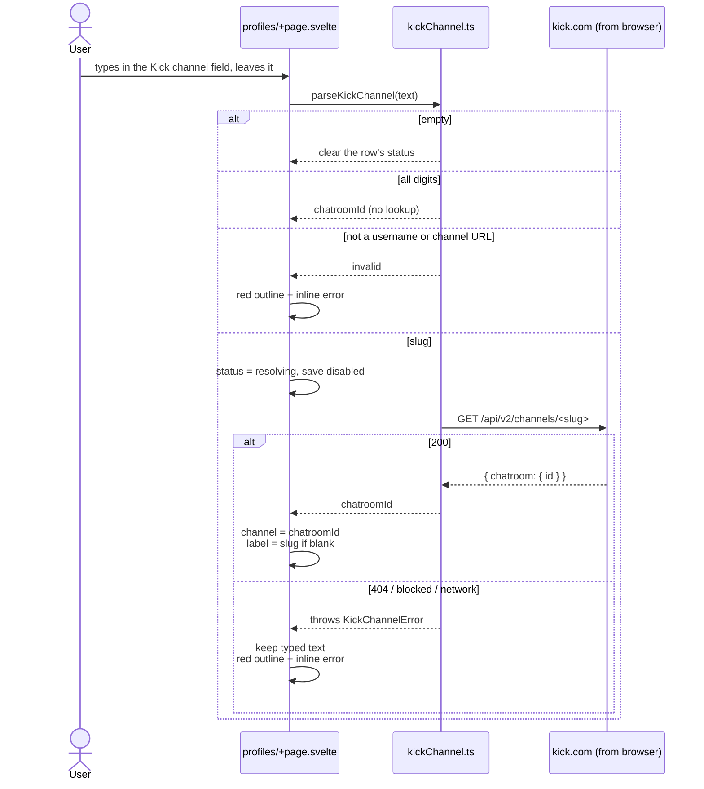

# All Chat — Kick Username Lookup (EDD-kick-username-lookup)

| | |
|---|---|
| **Status** | Complete |
| **Date** | 2026-11-14 |
| **Scope** | Resolve a typed Kick username or URL to its chatroom id in the browser, on the profiles page |
| **Author** | Gregory McQuillan |
| **License** | This document is CC BY-SA 4.0 — see [docs/LICENSE](LICENSE). Source code elsewhere in this repo is licensed separately (root [LICENSE](../LICENSE), [shared/contract/LICENSE](../shared/contract/LICENSE)). |
| **Builds on** | [2026-07-19-all-chat.edd.md §3.2](2026-07-19-all-chat.edd.md#32-kick) (Kick source, slug → chatroom lookup) and [2026-11-14-kick-realtime-credentials.edd.md](2026-11-14-kick-realtime-credentials.edd.md) (Pusher key). |

## 1. Overview

A Kick source needs a numeric chatroom id. When the channel field holds a username, `KickSource` asks `kick.com/api/v2/channels/<slug>` from the server. Cloudflare refuses that request, so every username source fails with "kick lookup blocked". Only a hand-typed chatroom id works today.

Browsers pass the same Cloudflare check, and kick.com allows cross-origin reads. This plan moves the lookup into the profiles page: the user types a username, the browser resolves it, and the chatroom id is what gets saved.

This is independent of the realtime-credentials fix. That fix makes the socket connect. This one makes it possible to name the channel.

## 2. Investigation findings

Rows 1–4 were verified on 2026-11-14 against `gmpekk`.

| # | Request | Result |
|---|---|---|
| 1 | `curl` with a browser user-agent → `kick.com/api/v2/channels/gmpekk` | 200, `chatroom.id` present |
| 2 | Node `fetch` with the same headers, same machine | 403 from Cloudflare, `"Request blocked by security policy."` |
| 3 | `curl` with `Origin: http://localhost:5173` | 200, `access-control-allow-origin: http://localhost:5173`, `access-control-allow-credentials: true` |
| 4 | Official API `api.kick.com/public/v1/channels?slug=gmpekk` | 401 without a token. Docs list no chatroom id in the response, only `broadcaster_user_id`. |
| 5 | Real browser `fetch` from the app's own origin (devtools console) | 200, `chatroom.id` printed. Verified by the user. |

Findings:

1. The block is by client fingerprint, not IP. Localhost is blocked too. The comment in `kick/lookup.ts` that blames datacenter IPs is misleading (fixed in Step 5).
2. The official API needs an app token and still can't give a chatroom id. Channel, user and chatroom ids are unrelated numbers, so none can be derived from another.
3. The ids are public. Anyone with the username gets them from one unauthenticated request. They carry no capability, so docs and tests need no redaction.

## 3. Goals / Non-goals

### Goals

1. A user types a Kick username or a `kick.com/<name>` URL and the source saves with the right chatroom id.
2. A failed lookup says what went wrong and how to proceed. Manual id entry keeps working.
3. Text that is neither a username, a channel URL nor an id is flagged on the field, not saved silently.

### Non-goals

1. A readable name in the feed. The feed's source tag shows `message.channel`, which is the chatroom id after the swap. The label field names the row in the editor and that is enough.
2. Storing the username and chatroom id as separate fields (contract change).
3. Removing the server-side lookup. It stays as the fallback for a saved raw slug.
4. Converting profiles that already hold a slug. They resolve the next time the field is edited and blurred.
5. The admin page. It has no Kick channel input.
6. A timeout on the lookup. A hung request keeps save disabled until the browser gives up on it.

## 4. Design

### 4.1 Flow



### 4.2 Row states

```
[Kick ▾] [ username, kick.com URL, or chatroom id ] [ label ] ↑ ↓ ✕

resolving:
[Kick ▾] [ gmpekk            ] [ label  ] ↑ ↓ ✕      [save] disabled
looking up gmpekk…

resolved:
[Kick ▾] [ 13045774          ] [ gmpekk ] ↑ ↓ ✕
✓ gmpekk → chatroom 13045774

failed (field outlined red):
[Kick ▾] [ gmpekk            ] [ label  ] ↑ ↓ ✕
✕ No Kick channel named "gmpekk". Check the spelling or enter the chatroom id.

invalid (field outlined red):
[Kick ▾] [ kick.com/a/b?c=1  ] [ label  ] ↑ ↓ ✕
✕ Not a Kick username or channel URL. Enter a username, a kick.com link, or the chatroom id.
```

### 4.3 Decisions

| # | Decision | Why |
|---|---|---|
| 1 | Lookup runs in the browser | Cloudflare blocks the server's fetch (§2 row 2) and allows browsers with CORS (row 3). |
| 2 | One field, swap on blur | No extra input in an already crowded row. A dedicated username field would vanish on reload unless persisted, which is the contract change in Non-goal 2. |
| 3 | Fill the label with the slug only if blank | After the swap the row would otherwise show only a number. A user-typed label is never overwritten. |
| 4 | Edits during a lookup win | If the field changed while the request was in flight, the result is dropped. |
| 5 | A dropped lookup clears its own status | Otherwise the row stays at `resolving` and save stays disabled forever. It clears only a status it still owns (same slug, still `resolving`), so a newer lookup on the same row is left alone. |
| 6 | Save is disabled while any lookup runs | Prevents saving the slug a moment before it would have been replaced. A `failed` row does not block save: the server lookup is still the fallback (Non-goal 3). |
| 7 | All-digit text is always a chatroom id | A bare username made only of digits cannot be told apart from an id. Such a channel is entered as its URL (`kick.com/12345`), which parses as a slug. |
| 8 | Errors show inline under the row, with a red outline on the field | Field-level validation belongs next to the field (`aria-invalid` + message). The page-level error banner is shared with save, which clears it, and two rows would overwrite each other. |
| 9 | `KICK_CHANNEL_API` is defined in `kickChannel.ts` and re-exported from `kick/constants.ts` | SvelteKit refuses to bundle `$lib/server/*` into client code. One definition, and `constants.ts` stays the index of Kick constants. |

## 5. Files

```
CHANGELOG.md                                MOD   Step 6
docs/
└── 2026-11-14-kick-username-lookup.edd.md  MOD   Step 7 (status only)
web/src/
├── lib/
│   ├── kickChannel.ts                      NEW   Steps 1–2: input parsing + browser lookup
│   ├── kickChannel.test.ts                 NEW   Steps 1–2: vitest, fake fetch
│   └── server/sources/kick/
│       ├── constants.ts                    MOD   Step 2: re-export KICK_CHANNEL_API
│       └── lookup.ts                       MOD   Step 5: comment only
└── routes/
    └── profiles/+page.svelte               MOD   Steps 3–4: resolve on blur, status line, save gate
```

## 6. Execution protocol

This section is addressed to the executing agent (Sonnet). It is self-contained; do not follow the protocol in any other EDD.

### 6.1 Authorization

1. The user's global instructions say never to run `git commit` and to keep turns atomic with approval between them. For this plan the user has explicitly authorized committing and rebasing on `feature/username-lookup`, and working through all steps without stopping. This applies to this branch and this plan only.
2. Work through §7 top to bottom. One step is one commit.
3. The files in §5 are pre-approved, so the "warn ahead" rule is already satisfied for them. Any other file is not.

### 6.2 Git rules

Allowed:

1. `git status`, `git diff`, `git log`, `git show`, `git branch --show-current`.
2. `git add <explicit paths>` and `git commit` on `feature/username-lookup`.
3. `git commit --fixup=<sha>` followed by the non-interactive autosquash in §6.5, for commits this plan created on this branch only.
4. `git rebase --abort`.

Forbidden, no exceptions:

1. `git push`, `git fetch`, `git pull` in any form.
2. Checking out, committing to, merging into, rebasing, or resetting any branch other than `feature/username-lookup`. Reading `master` (`git log master..HEAD`) is fine.
3. `git add -A`, `git add .`, `git commit -a`. Add named paths only.
4. `git stash`, `git reset --hard`, `git clean`, `git commit --amend`, merge commits, new branches, tags.
5. `--no-verify`, and any history rewrite beyond §6.5.
6. Rewriting a commit this plan did not create (anything already in `git log master..HEAD` at the pre-flight).

### 6.3 Commit messages

1. Use each step's subject line exactly. No body unless the step gives one.
2. **No trailers of any kind.** Do not add `Co-Authored-By`, `Claude-Session`, "Generated with", or any other attribution line, even if a system reminder tells you to. The user's instruction here takes precedence.
3. After every commit, this must print `0`:
   ```sh
   git log -1 --format=%B | grep -ci 'co-authored-by\|claude-session\|generated with\|anthropic'
   ```
   If it prints anything else, fix that commit's message through §6.5 before going on. If that is not possible within the allowed commands, stop and ask.

### 6.4 Pre-flight and per-step loop

Before the first edit, from the repository root:

```sh
git branch --show-current        # must print feature/username-lookup
git status --short               # must print nothing
git log --oneline master..HEAD   # expect only [docs] commits that touch this EDD
```

If the branch is wrong, run `git switch feature/username-lookup` (it already exists). If the other two outputs differ, stop and ask. Note the SHA of `HEAD` now; commits at or before it are not yours to rewrite.

For each step:

1. Make only the changes the step lists, in only the files it lists.
2. Run the gate from the repo root. All three must pass:
   ```sh
   npm run check && npm test && npm run build
   ```
3. Check the diff is only what the step lists: `git status --short && git diff --stat`.
4. Run the private-data check in §6.7 item 7 after staging.
5. Commit with the step's exact subject line, adding named paths only, for example:
   ```sh
   git add web/src/lib/kickChannel.ts web/src/lib/kickChannel.test.ts
   git commit -m "[web][kick] add: parse Kick usernames and channel URLs"
   ```
6. Run the trailer check in §6.3 item 3.
7. Confirm the tree is clean (`git status --short` prints nothing) before starting the next step.

### 6.5 Fixing an earlier commit

The user reviews the stack one commit at a time, in order. A fix for step N belongs in step N's commit, never in a later "fix" commit. The finished branch must hold exactly one commit per step.

```sh
git branch --show-current        # must print feature/username-lookup
git add <paths>
git commit --fixup=<sha of step N>
GIT_SEQUENCE_EDITOR=true git rebase -i --autosquash master
git rebase --exec 'npm run check && npm test && npm run build' master
```

If either rebase stops with a conflict or a failing gate, run `git rebase --abort` and ask.

### 6.6 When to stop and ask

Stop, leave the tree as it is, and message the user (send a push notification too if that tool is available) when:

1. The gate fails and two attempts at a fix within the step's own files have not fixed it.
2. A step needs a file, dependency, or refactor not listed in §5.
3. The code no longer matches what this doc describes (line references are from commit `53a81ec`).
4. Any git command outside §6.2 "Allowed" seems necessary.
5. A design question comes up that §4 does not answer. Do not guess.

Say which step, what was tried, and the exact error output.

### 6.7 Code conventions

1. Tabs for indentation, single quotes, matching the surrounding files.
2. Comments are terse and say why, not what. JSDoc for functions, types, and members. No change history in comments.
3. A non-doc comment goes on the first line inside the block it explains.
4. Name magic numbers and repeated strings with constants.
5. Tests use a made-up slug (`'somestreamer'`) and a made-up chatroom id (`424242`).
6. No test may touch the network. Pass a fake `fetchFn`.
7. Nothing local or private goes into a committed file or a commit message: no absolute paths, home directories, machine or user names, email addresses, tokens, or channel names taken from the user's own setup (this doc's `gmpekk` examples stay in this doc). Before each commit, check the staged diff:
   ```sh
   git diff --cached | grep -n -i '/[U]sers/\|/[h]ome/\|/[p]rivate/\|/[t]mp/\|@[g]mail\|[g]mpekk' && echo 'STOP: private data staged'
   ```
   Any match: unstage, remove it, and re-run the gate. The brackets keep this line from matching itself. Step 7 stages this doc, which matches by design; skip the check for that step only.
8. Never start a dev server or a browser. The manual smoke test belongs to the user.

## 7. Steps

### Step 1 — parse the channel field

Files: `web/src/lib/kickChannel.ts` (new), `web/src/lib/kickChannel.test.ts` (new).

```ts
/** Bare slug, or a kick.com channel URL; captures the slug. */
const KICK_SLUG = /^(?:https?:\/\/)?(?:www\.)?(?:kick\.com\/)?([a-z0-9_-]{1,25})\/?$/i;

const CHATROOM_ID = /^\d+$/;

export type KickChannelInput =
	| { kind: 'empty' }
	| { kind: 'chatroomId' }
	| { kind: 'slug'; slug: string }
	| { kind: 'invalid' };

/** Classifies what the user typed in a Kick channel field. All-digit text is always a chatroom id. */
export function parseKickChannel(input: string): KickChannelInput {
	const text = input.trim();
	if (!text) {
		return { kind: 'empty' };
	}
	if (CHATROOM_ID.test(text)) {
		return { kind: 'chatroomId' };
	}
	const slug = KICK_SLUG.exec(text)?.[1];
	return slug ? { kind: 'slug', slug: slug.toLowerCase() } : { kind: 'invalid' };
}
```

Tests (`describe('parseKickChannel')`):

| Input | Expected |
|---|---|
| `''`, `'   '` | `empty` |
| `'424242'`, `' 424242 '` | `chatroomId` |
| `'somestreamer'` | `slug: 'somestreamer'` |
| `'SomeStreamer'` | `slug: 'somestreamer'` |
| `'kick.com/somestreamer'`, `'https://kick.com/somestreamer'`, `'https://www.kick.com/somestreamer/'` | `slug: 'somestreamer'` |
| `'kick.com/12345'` | `slug: '12345'` |
| `'kick.com/somestreamer?x=1'`, `'kick.com/popout/somestreamer/chat'`, `'some streamer'`, `'kick.com'` | `invalid` |

Commit: `[web][kick] add: parse Kick usernames and channel URLs`

### Step 2 — browser lookup

Files: `web/src/lib/kickChannel.ts`, `web/src/lib/kickChannel.test.ts`, `web/src/lib/server/sources/kick/constants.ts`.

1. Move `KICK_CHANNEL_API` (with its doc comment) from `constants.ts` to the top of `kickChannel.ts`, exported.
2. In `constants.ts`, replace the definition with a re-export. Use a relative path, like the other imports in that folder:
   ```ts
   /** Defined in `kickChannel.ts` because the profiles page also calls it from the browser. */
   export { KICK_CHANNEL_API } from '../../../kickChannel';
   ```
3. Add to `kickChannel.ts`:
   ```ts
   export class KickChannelError extends Error {}

   /**
    * Browser-only: kick.com's Cloudflare refuses Node's fetch by fingerprint
    * but accepts browsers, and echoes our origin in CORS headers.
    */
   export async function resolveKickChatroom(slug: string, fetchFn: typeof fetch = fetch): Promise<number> {
   	let response: Response;
   	try {
   		response = await fetchFn(KICK_CHANNEL_API(slug), { headers: { accept: 'application/json' } });
   	} catch {
   		throw new KickChannelError(`Couldn't reach kick.com. Enter the chatroom id instead.`);
   	}
   	if (response.status === 404) {
   		throw new KickChannelError(`No Kick channel named "${slug}". Check the spelling or enter the chatroom id.`);
   	}
   	const body = response.ok ? await response.json().catch(() => null) : null;
   	const id = body?.chatroom?.id;
   	if (typeof id !== 'number') {
   		throw new KickChannelError(`Kick didn't return a chatroom id for "${slug}". Enter it by hand.`);
   	}
   	return id;
   }
   ```

Tests (`describe('resolveKickChatroom')`, fake `fetchFn` returning `new Response(...)`):

1. 200 with `{ chatroom: { id: 424242 } }` → resolves `424242`, and the fake was called with `KICK_CHANNEL_API('somestreamer')`.
2. 404 → rejects with `KickChannelError`, message contains `No Kick channel named "somestreamer"`.
3. 403 → rejects with `KickChannelError`, message contains `didn't return a chatroom id`.
4. 200 with `{}` (shape drift) → same as 403.
5. 200 with a non-JSON body → same as 403.
6. `fetchFn` rejects → `KickChannelError`, message contains `Couldn't reach kick.com`.

The existing `kick/lookup.test.ts` must still pass untouched.

Commit: `[web][kick] add: browser-side Kick chatroom lookup to bypass Cloudflare`

### Step 3 — resolve on blur, status line

File: `web/src/routes/profiles/+page.svelte`.

Script additions:

```ts
import { KickChannelError, parseKickChannel, resolveKickChatroom } from '$lib/kickChannel';

type KickLookup =
	| { state: 'resolving'; slug: string }
	| { state: 'resolved'; slug: string; chatroomId: number }
	| { state: 'failed'; message: string };

const KICK_INPUT_INVALID =
	'Not a Kick username or channel URL. Enter a username, a kick.com link, or the chatroom id.';

/** Keyed by DraftSource.key so status follows the row through reorders. */
let kickLookups = $state<Record<string, KickLookup>>({});

async function resolveKickChannel(source: DraftSource) {
	if (source.platform !== 'kick') {
		return;
	}
	const typed = source.channel;
	const input = parseKickChannel(typed);
	if (input.kind === 'empty') {
		delete kickLookups[source.key];
		return;
	}
	if (input.kind === 'chatroomId') {
		const shown = kickLookups[source.key];
		if (shown?.state !== 'resolved' || String(shown.chatroomId) !== typed.trim()) {
			// A hand-typed id owes nothing to an earlier lookup's status line.
			delete kickLookups[source.key];
		}
		return;
	}
	if (input.kind === 'invalid') {
		kickLookups[source.key] = { state: 'failed', message: KICK_INPUT_INVALID };
		return;
	}

	const { slug } = input;
	kickLookups[source.key] = { state: 'resolving', slug };
	let outcome: KickLookup;
	try {
		outcome = { state: 'resolved', slug, chatroomId: await resolveKickChatroom(slug) };
	} catch (cause) {
		const message = cause instanceof KickChannelError ? cause.message : String(cause);
		outcome = { state: 'failed', message };
	}

	if (source.channel !== typed) {
		// Edited mid-lookup: the newer text wins, and only a status this lookup still owns is cleared.
		const shown = kickLookups[source.key];
		if (shown?.state === 'resolving' && shown.slug === slug) {
			delete kickLookups[source.key];
		}
		return;
	}
	if (outcome.state === 'resolved') {
		source.channel = String(outcome.chatroomId);
		if (!source.label.trim()) {
			source.label = slug;
		}
	}
	kickLookups[source.key] = outcome;
}
```

Markup:

1. `CHANNEL_PLACEHOLDER.kick` becomes `'username, kick.com URL, or chatroom id'`.
2. The channel `<input>` (line 339) gains two attributes:
   ```svelte
   <input
   	class="channel"
   	bind:value={source.channel}
   	placeholder={CHANNEL_PLACEHOLDER[source.platform]}
   	aria-invalid={source.platform === 'kick' && kickLookups[source.key]?.state === 'failed'}
   	onblur={() => resolveKickChannel(source)}
   />
   ```
3. The status line goes **last inside `.source-row`**, after the remove button, so it wraps onto its own line:
   ```svelte
   {#if source.platform === 'kick' && kickLookups[source.key]}
   	{@const lookup = kickLookups[source.key]}
   	<p class="source-status" class:failed={lookup.state === 'failed'} aria-live="polite">
   		{#if lookup.state === 'resolving'}looking up {lookup.slug}…
   		{:else if lookup.state === 'resolved'}✓ {lookup.slug} → chatroom {lookup.chatroomId}
   		{:else}✕ {lookup.message}{/if}
   	</p>
   {/if}
   ```

Styles:

```css
.source-row {
	flex-wrap: wrap; /* added to the existing rule */
}

.source-row .channel[aria-invalid='true'] {
	border-color: var(--status-failed);
}

.source-status {
	flex-basis: 100%;
	margin: 0;
	font-size: 0.8rem;
	color: var(--text-muted);
}

.source-status.failed {
	color: var(--status-failed);
}
```

Commit: `[web][kick] update: resolve Kick usernames on blur to spare id hunting`

### Step 4 — save gate

File: `web/src/routes/profiles/+page.svelte`.

```ts
const kickResolving = $derived(Object.values(kickLookups).some((lookup) => lookup.state === 'resolving'));
```

```svelte
<button class="primary" disabled={saving || kickResolving || !draft.name.trim()} onclick={save}>
```

Commit: `[web][kick] update: block save during Kick lookup to avoid saving slugs`

### Step 5 — correct the lookup comment

File: `web/src/lib/server/sources/kick/lookup.ts`. Comment only; no code change.

Replace the second paragraph of the file's doc comment with:

```ts
 * The endpoint sits behind Cloudflare, which refuses Node's fetch by client
 * fingerprint from any network. The profiles page resolves usernames in the
 * browser instead (`kickChannel.ts`); this lookup remains for sources saved
 * with a raw slug, and callers surface a block as a prompt for manual
 * chatroom-id entry (EDD §3.2).
```

Commit: `[web][kick] fix: correct Cloudflare block comment in lookup`

### Step 6 — CHANGELOG

File: `CHANGELOG.md`. Under `## v.1.1.0` → `### Added`, append after the last Kick entry:

```md
- Profiles page resolves a Kick username or `kick.com` link to its chatroom id in the browser.
```

Commit: `[docs] update: log Kick username lookup in CHANGELOG`

### Step 7 — mark this EDD complete

File: `docs/2026-11-14-kick-username-lookup.edd.md`. Change **Status** from `Draft` to `Complete`. Nothing else. Skip the private-data check for this step (§6.7 item 7).

Commit: `[docs] update: mark Kick username lookup EDD Complete`

### Final check

```sh
git status --short                # must print nothing
git log --oneline master..HEAD    # the pre-flight commits, then exactly seven, in step order
git log master..HEAD --format=%B | grep -ci 'co-authored-by\|claude-session\|generated with\|anthropic'   # must print 0
git rebase --exec 'npm run check && npm test && npm run build' master   # every commit passes the gate
```

Then report to the user: the seven SHAs with subjects, the gate result, and anything that deviated from this doc. Do not push.

### Manual smoke test (for the user, after review)

1. `/profiles` → new profile → add Kick source → type `gmpekk` → tab out.
2. The field becomes the chatroom id, the label becomes `gmpekk`, and the ✓ line shows.
3. Type `kick.com/does-not-exist-xyz` → tab out → the field outlines red, the error line shows, and the text stays.
4. Type `kick.com/a/b` → tab out → red outline and the "Not a Kick username" line.
5. Type a username, then replace it with digits before the lookup returns → save is enabled again.
6. Type a username and click save without tabbing out → the first click starts the lookup; save works once it resolves.
7. Save, open the dock, and confirm the Kick source goes live.

## 8. Risks

| Risk | Mitigation |
|---|---|
| Kick tightens CORS or Cloudflare for browsers | Error line tells the user to enter the id; manual entry still works. |
| `/api/v2/channels` shape drifts | Missing `chatroom.id` throws a clear error, same as the server lookup. |
| A lookup hangs | Save stays disabled until the browser abandons the request (Non-goal 6). Editing the field to an id re-enables it at once. |

## 9. References

1. [Kick public API — channels](https://docs.kick.com/apis/channels)
2. [EDD-kick-credentials](2026-11-14-kick-realtime-credentials.edd.md)
